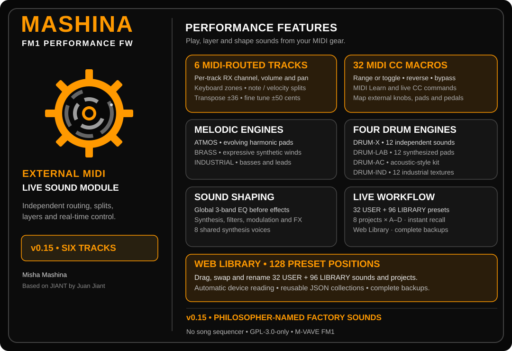

# MASHINA — FM1 Performance Firmware v0.11

**MASHINA** turns the **M-VAVE FM1** into a six-track sound module designed for **external MIDI keyboards, pad controllers and live performance**. Play multiple sounds together, split a keyboard into zones, shape sounds while performing and recall projects quickly.

Developed by **Misha Mashina**, based on [JIANT by Juan Ignacio Antonucci (Juan Jiant)](https://github.com/juanjiant-bit/JIANT) and [Felucca](https://github.com/hugelton/Felucca). Free software under **GPL-3.0-only**.

### MASHINA online

[Project homepage](https://mishamashinamm.github.io/mashina-fm1-fw/) · [Play in emulator](https://mishamashinamm.github.io/mashina-fm1-fw/emu/) · [FM1 web installer](https://mishamashinamm.github.io/mashina-fm1-fw/webapp/installer/) · [Web editor](https://mishamashinamm.github.io/mashina-fm1-fw/webapp/editor/) · [User manual](https://mishamashinamm.github.io/mashina-fm1-fw/manual/)

## What MASHINA adds to JIANT

MASHINA retains JIANT's sound-making capabilities while expanding the FM1 for hands-on MIDI performance:

| Feature | What's included |
| --- | --- |
| **Additional melodic engines** | **ATMOS** for evolving pads, **BRASS** for synthetic wind sounds and **INDUSTRIAL** for aggressive basses and leads. |
| **Expanded drums** | **DRUM-X** with 12 sounds, plus three additional 12-sound kits: **DRUM-LAB** (electronic percussion), **DRUM-AC** (acoustic-style drums) and **DRUM-IND** (metallic, mechanical and industrial effects). |
| **Flexible MIDI routing** | Assign independent MIDI receive channels to six tracks; layer sounds, build keyboard splits and set note and velocity zones. |
| **Track tuning** | Transpose each track by up to three octaves and adjust fine tuning independently. |
| **Live MIDI control** | 32 assignable MIDI CC macros, MIDI Learn, performance commands and MIDI-triggered sound variations. |
| **Live mixer and sound shaping** | Six-track mixer with note activity indicators, individual track controls and shared three-band EQ. |
| **Project management** | Save and clear project slots, retain performance settings and use quick project recall during a set. |
| **Performance interface** | Streamlined, animation-free orange-and-gray UI, repurposed hardware controls and panic mode for immediate silence. |

MASHINA has **eight shared synthesis voices in total**, not eight per track. It is focused on live playing; the original song sequencer is disabled.

For drum note layouts, sound parameters, MIDI mappings, hardware controls and complete operating instructions, see the **[User Manual](https://mishamashinamm.github.io/mashina-fm1-fw/manual/)** (available in English, Serbian, Spanish, Russian, Japanese and Hindi).

## Factory sound library — v0.11

The melodic banks contain 20 ANALOG presets (including CICERO and PLUTARCH), 12 INDUSTRIAL, 5 BRASS and 8 ATMOS, alongside custom PHASE, WHEEL, NOISE, VOICE, LOFI and FM6 sounds. The four drum engines retain their synthesis and have renamed factory kits: **BUTTLER-1–9** (DRUM-X), **ZIZEK-1–3** (DRUM-LAB), **KRIPKE-1–3** (DRUM-AC) and **BADIOU-1–3** (DRUM-IND).

Many factory presets are named after philosophers and thinkers from different periods of history.

## Made for live performance

**MASHINA puts the FM1 under your hands instead of behind menus.** Use a MIDI keyboard or pad controller to play several tracks at once, build splits and layers, and change the sound as you perform. Assign knobs, sliders or pedals to the parameters that matter to you, then reshape tones, trigger variations and balance tracks without interrupting the music.

**Your setup stays flexible from song to song.** Combine melodic and percussion engines, give each track its own MIDI channel and playing range, and save complete configurations as projects for quick recall on stage. The mixer, streamlined controls and panic shortcut keep essential performance functions close at hand. MASHINA works equally well as the centerpiece of a compact MIDI rig or as an additional sound module in a larger setup.

## Install or try in a browser

Use the **[FM1 web installer](https://mishamashinamm.github.io/mashina-fm1-fw/webapp/installer/)** to install MASHINA with a compatible desktop browser, or **[try the emulator](https://mishamashinamm.github.io/mashina-fm1-fw/emu/)** without flashing your device. The **[web editor](https://mishamashinamm.github.io/mashina-fm1-fw/webapp/editor/)** supports device management and backup/restore.

**Before flashing:** back up projects, user presets and settings, and keep a known-working recovery firmware available. Projects saved with newer firmware may not be compatible with older versions.

**Current version:** v0.11.

## Credits and licensing

**MASHINA:** Misha Mashina.

**JIANT:** Juan Ignacio Antonucci (Juan Jiant) — [source repository](https://github.com/juanjiant-bit/JIANT) and [project/manual](https://juanjiant-bit.github.io/JIANT/).

**Felucca:** Hügelton Instruments, including Leo Kuroshita and other contributors. Additional credits are preserved in source headers, firmware ABOUT information and bundled license notices.

Distributed under **[GPL-3.0-only](LICENSE)**. Original author credits and third-party licenses are retained.
