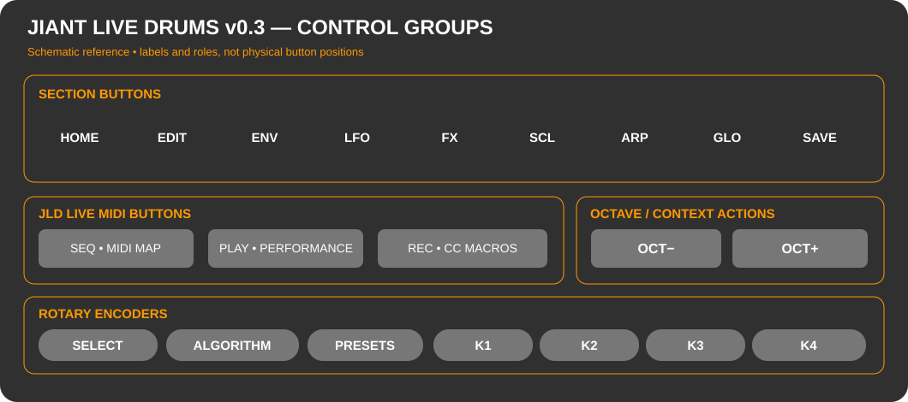
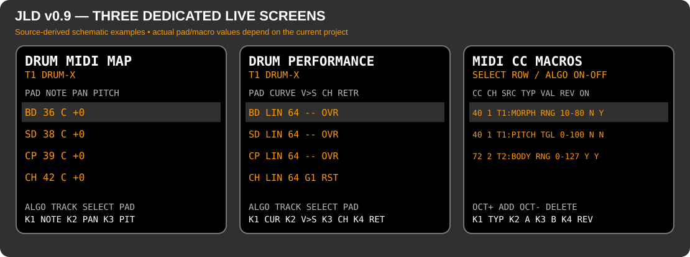

# JIANT LIVE DRUMS v0.9 — User Manual

This is the **JIANT LIVE DRUMS (JLD) v0.9** user manual for the M-VAVE FM1, covering live controls, MIDI performance, **Keyboard Zones (note and velocity ranges)**, drum kits, sound engines, project management and the v0.7 **BRASS** and **INDUSTRIAL** synthesizers. This fork disables the original JIANT sequencer. The firmware and its [README](../README.md) are the authoritative implementation references; diagrams below are annotated schematics, not photographs of the physical screen.

> **Canonical location:** [`docs/JLD_MANUAL_V0.9.md`](JLD_MANUAL_V0.9.md). The former v0.3 filename links here for backward compatibility. The [web interactive manual](https://mishamashinamm.github.io/jiant-live-drums/manual/) is inherited from original JIANT and does not fully describe these Drums-specific pages.

> **UI build status (ui-changes):** This new black/white/gray/orange UI is a **v0.9 device-test candidate, not yet tested on a physical FM1**. The November 18 Korg X5D tests verified the previous v0.9 feature release, not this updated screen build. Do not mark this theme device-tested until a new flash-and-test report. The installer for this branch is a separately downloadable GitHub Actions artifact, not the public installer.\n\n> **Safety and testing of previous v0.9 release:** Back up projects, presets and sound banks before changing firmware. **v0.9 was flashed and tested successfully on a physical FM1 with a Korg X5D MIDI keyboard on November 18, 2026.** The previous main-branch v0.9 release preserves the tested feature implementation; the separate ui-changes build still requires FM1 display tests. Device validation is functional, not an exhaustive long-duration/recovery guarantee.

## Visual language — v0.9 orange-accent UI test candidate

The performance-oriented UI uses a **black background, white primary text and neutral gray labels/panels** with a single **orange `#FF9900` accent**. Numbers and other editable knob values are orange. Page titles, breadcrumbs and the JIANT LIVE DRUMS boot wordmark are orange; value gauges still use a gray-to-white intensity scale. A **selected MIXER/ZONES/TUNING row is solid white with black text** for high contrast. In **SAVE → PROJECT → SECTIONS** and **SAVE → LIBRARY → PROJECTS**, **occupied slots/section chips are orange, empty slots gray** and the selected project retains a white border. Animations remain disabled.

**Navigation fix:** pressing HOME while viewing GLO now redraws HOME instead of leaving the GLO mixer over it. Knobs continue to edit HOME parameters. The UI change does not alter the audio engine, project format, MIDI routing, or any menu/knob mapping. This is an **emulator-verified change awaiting physical display testing**.

## 1. Physical controls and navigation

### 1.1 Buttons and rotary controls

| Control | Ordinary operation | Important context |
| --- | --- | --- |
| **HOME** | Open HOME; a repeat tap moves to its next group | **Hold HOME** to open or close MENU; a tap also closes MENU. |
| **EDIT** | Sound-engine editing | Pages differ for synthesizers (including BRASS/INDUSTRIAL EDIT 3), FM6, DRUM-X and DRUM-LAB. |
| **ENV** | Envelopes, destination and stage pages | May expose track and individual envelope views. |
| **LFO** | Modulation matrix, LFO and MSEQ | The original engine M1–M4 macros are separate from JLD REC macros. |
| **FX** | Track sends/effects and global buses | Delay, reverb, chorus, slicer and master/punch groups follow. |
| **SCL** | Scale and chord controls | Works on the selected track. |
| **ARP** | Arpeggiator controls | ARP and ARP 2 pages. |
| **GLO** | Mixer, sends, global and system pages | Opens at MIX → MIXER; obsolete LIVE/MANO and LIVE/RIELES pages are removed from navigation. |
| **SAVE** | Preset, project and tool pages | Store edited settings explicitly when you want to keep them. |
| **SEQ** | **DRUM MIDI MAP** | Does not start the original sequencer. |
| **PLAY** | **DRUM PERFORMANCE** | Does not start the original transport. |
| **REC** | **MIDI CC MACROS** | Creates/edits up to 32 project macros; does not record a sequence. |
| **OCT− / OCT+** | Lower/raise the playing octave | Both together reset the offset; the live screens repurpose them. |
| **SELECT** | Move between visible pages | On SEQ/PLAY chooses a pad; on REC chooses a macro. |
| **ALGORITHM** | Change active track | On REC it instead turns the highlighted macro off/on. |
| **PRESETS** | Browse presets | Browses presets on most pages; on GLO → MIXER it adjusts the master DJ Filter. |
| **K1–K4** | Edit displayed parameters | Some columns may be unused or have special selection functions. |

The normal keyboard octave offset is **−3 to +3**; this is separate from the per-track ±36-semitone transpose. Changing a parameter typically acts immediately, but project-specific changes are only retained across loading/reboot once the project is saved.

### 1.2 Moving between pages

1. Press a section button (for example, **EDIT**). It opens the last page remembered for that section.
2. Turn **SELECT** to move through available pages, one page per detent. It stops at the ends rather than wrapping.
3. Press the same section button again to jump to the next **group** of pages in that section.
4. Turn **K1–K4** to edit the controls shown on the page. If a control is dimmed or absent, it may not apply to the selected engine.
5. Turn **ALGORITHM** to move between the active tracks (normally four, optionally six).

Navigation is **context-dependent**: choosing a different engine changes EDIT's page list; the REC/SEQ/PLAY live pages intercept SELECT, ALGORITHM and K1–K4 for their own tables.

### 1.3 Hold combinations and layers

| Gesture | Behavior |
| --- | --- |
| **Hold HOME** | Open/close settings MENU. |
| **Hold GLO + turn SELECT** | Adjust tempo (BPM). |
| **Hold ENV, SCL, ARP or SAVE + turn SELECT** | Jump into that section and move through its pages. |
| **Hold EDIT, LFO or FX + turn SELECT** | A *dice/randomize* action for the corresponding sound/modulation/effects, rather than ordinary page navigation. Treat as a potentially audible edit. |
| **Hold HOME + turn SELECT** | Access HOME's generator pages. |
| **Hold a section button + turn PRESETS** | No ordinary page navigation; this combination is intentionally suppressed. |
| **OCT− + OCT+** | Reset ordinary keyboard octave offset to zero; this is not the meaning of OCT buttons in every editor. |

**Performance layers:** Some held buttons expose a second control layer using the keys and knobs. These are distinct from ordinary button taps. The exact performance-layer assignments are context-sensitive; use the on-screen layer labels. In particular, do not confuse the original **M1–M4** engine macros with the REC MIDI CC macros.

### 1.4 Settings MENU

Hold **HOME**. MENU has six visible physical pages, each with K1–K4 controls:

| Page | K1 | K2 | K3 | K4 |
| --- | --- | --- | --- | --- |
| **SCREEN** | Scope | Screen sleep | LED glow | Scale LEDs |
| **AUDIO** | Speaker EQ | Tracks 4/6 | Load | BPM lock |
| **CLICK** | Click | Click level | Count-in | MIDI out |
| **MIDI/USB** | MIDI Learn | Learn clear | USB audio mode | USB level |
| **CONTROLS** | Hold time | Knob speedup | FX latch | Panel calibration |
| **SYSTEM** | Restore last | CPU cores | CPU clock | About |

Turn **SELECT** to change the MENU page; **ALGORITHM** changes its higher-level tab. Turn the relevant **K** knob to change a value. Some action entries require **OCT+** after selection; in particular, **LEARN CLEAR** is destructive to the stored learn mappings. HOME exits MENU.

> Older JIANT screenshots may show other MENU arrangements. The table above comes from JLD's six-page layout.

## 2. Tracks, GLO, EQ and MIDI routing

Press **GLO** from another section to open **MIX → MIXER**. The MIXER contains six track rows; select a row using **ALGORITHM**.

| MIXER knob | Function | Details |
| --- | --- | --- |
| **K1** | Track MIDI RX channel | 1–16; duplicate assignments allowed. Shows **LIVE** when a temporary CC override is active. Turning K1 clears that track's override. |
| **K2** | Track volume | Independent level for each track. |
| **K3** | Track pan | Independent stereo position. |
| **K4** | Reserved | Unused on MIXER. TRN has moved to the third GLO MIX page, **TUNING**. |
| **PRESETS rotary** | Master **DJ Filter** | Acts as the master filter **only on MIXER**; elsewhere it retains preset-browsing behavior. |

The GLO navigation is **MIXER → ZONES → TUNING → SENDS → EQ → GLOBAL → SYSTEM**, with MIXER as the entry point from other sections. Previous LIVE **MANO** and **RIELES** pages no longer appear. The **TRACKS 4/6** option is in **MENU → AUDIO**; track 5/6 RX assignments can be edited and saved while those tracks are inactive.

**On TUNING, TRN affects incoming USB/TRS MIDI and the FM1 keyboard.** Changing transpose while a note is held affects *subsequent* notes, not the already sounding pitch; note-off/sustain release still matches the originally played note. Legacy projects without transpose information start with zero transpose.

### 2.1 Routing mode

In **GLO → SYSTEM**, select **ROUTE**:

| ROUTE | Meaning |
| --- | --- |
| **1-4** | Match assigned MIDI input channels to active tracks 1–4. |
| **1-6** | Match assigned MIDI input channels to active tracks 1–6 (subject to the TRACKS setting). |
| **SEL** | Incoming MIDI follows the currently selected track. |

To layer sounds, assign T1, T2 and optionally T3 the same RX channel (for example CH1) and choose **1-4** or **1-6**. Each track has its own patch, level, pan and transpose. Track and note ownership follows the sounding voices to prevent stuck notes after routing changes; effects tails may continue.

### 2.2 Keyboard Zones — note and velocity ranges (new in v0.8)

Open **GLO → MIX → ZONES**, **immediately after MIXER**. This screen uses the same six-row layout and the same **ALGORITHM** rotary to select a track. Each row shows its static **track number and sound name**, followed by four editable fields controlled by the hardware knobs:

| Column | Knob | Valid settings | Factory/default range |
| --- | --- | --- | --- |
| **MIN** | K1 | Lowest accepted MIDI note, 0–127 | 0 = C−1 |
| **MAX** | K2 | Highest accepted MIDI note, 0–127 | 127 = G9 |
| **V.MIN** | K3 | Lowest accepted Note On velocity, 1–127 | 1 |
| **V.MAX** | K4 | Highest accepted Note On velocity, 1–127 | 127 |

MIN and MAX are displayed as **musical note names** using the firmware convention (**MIDI note 48 = C3; note 60 = C4**). Both note and velocity boundaries are **inclusive**. If a knob reaches the other boundary, it stops there rather than producing an impossible range. All six tracks—including T5 and T6 while inactive—have independently editable zones.

**Routing sequence:** The incoming **RX MIDI channel** determines candidate tracks, then each track's note and velocity ranges decide whether it sounds, then that track's own **TRN** transpose is applied. Thus three tracks may all have RX **CH1** and still play separate or overlapping keyboard areas. **Note Off and sustain release the tracks that accepted the original Note On**, even if you change a boundary while holding notes. MIDI Note On velocity zero is interpreted as Note Off.

**Examples (all tracks assigned RX CH1):**

| Track | MIN | MAX | V.MIN–V.MAX | Effect |
| --- | --- | --- | --- | --- |
| T1 | C−1 (0) | B2 (47) | 1–127 | Low notes |
| T2 | C3 (48) | B4 (71) | 1–127 | Middle keyboard |
| T3 | C5 (72) | G9 (127) | 1–127 | High notes |

To create **overlapping layers**, let T2 end above T3's start (for example T2 MAX = C6 while T3 MIN = C5). To make a **velocity split**, give T1 and T2 the same note range, but set T1 V.MAX = 80 and T2 V.MIN = 81; overlapping velocity ranges also allow both sounds to play.

**Important input distinction:** Zones currently distribute **external USB/TRS MIDI** among tracks. The FM1's **own small keyboard still targets the selected track only**, so its built-in buttons (and the emulator's own virtual FM1 keybed) do not provide multitrack split demonstrations. Use an external MIDI keyboard or the emulator's MIDI input controls for testing.

**Saving:** Zone values are **saved with each project**, restored after reloading, and cleared to full range in NEW PROJECT. Projects created before v0.8 default to **notes 0–127 and velocity 1–127** on every track. The settings are stored in an optional compact project block, so back up projects before installing older firmware, which may not understand the new data.

### 2.3 TUNING — per-track semitone transpose and fine detune (new in v0.9)

Open **GLO → MIX → TUNING**, the **third** mixer-style page, immediately after ZONES. It has the same six visible track rows; use the **ALGORITHM** rotary to select T1–T6. Each track displays its own independent TRN and FINE settings. The two remaining columns are reserved.

| TUNING knob | Parameter | Range | Default |
| --- | --- | --- | --- |
| **K1** | **TRN** — chromatic transpose | **−36 to +36 semitones** (three octaves in either direction) | 0 |
| **K2** | **FINE** — detuning in cents | **−50 to +50 cents**, where 100 cents = one semitone | 0 |
| **K3** | Reserved | Unused | — |
| **K4** | Reserved | Unused | — |

**Layered instruments:** give T1, T2 and T3 the same MIDI RX channel and overlapping note zones, then set FINE to **−8**, **0** and **+8** cents. The three tracks continue to play the same MIDI note, but with different oscillator tuning, producing gentle beating and a thicker layer. Adjust VOL and PAN on MIXER.

**Pitch/routing order:** external MIDI channel → ZONES note/velocity filter on the **untransposed input** → TRN semitone shift → pitched engine. FINE changes rendered pitch by fractions of a semitone and **does not alter MIDI note numbers or zone boundaries**. The firmware also applies fine tuning to independently synthesized oscillators to preserve internal oscillator detuning. Drum engines DRUM-X and DRUM-LAB retain their original pitch and note mappings: TRN/FINE are ignored for drum tracks.

**Safety at note boundaries:** the shifted MIDI note must remain within **0–127**; out-of-range notes are ignored. Note Off and sustain release the original sounding note even if TRN or zones are changed after Note On. Fine tuning changes the sounding pitch without changing note ownership.

**Project saving:** TRN and FINE are saved **independently for all six tracks per project**, included in autosave, and reset to **0** for NEW PROJECT. Existing project transpose settings from v0.6–v0.8 remain compatible, including the legacy **−24…+24** stored values. Extended TRN values and nonzero FINE values use new compact optional project blocks. Older firmware may not recognize them; **back up projects before a downgrade**.

The owner confirmed successful hardware operation with a **Korg X5D** connected to an FM1 on **November 18, 2026**.

### 2.4 Shared global EQ

Open **GLO → MIX → EQ**:

| Band | Center / shelf frequency | Gain |
| --- | --- | --- |
| **LOW** | 50 Hz low shelf | −15 to +15 dB |
| **MID** | 700 Hz peaking EQ | −15 to +15 dB |
| **HIGH** | 10 kHz high shelf | −15 to +15 dB |
| **ON** | EQ bypass switch | On / Off |

This is **one shared EQ for all tracks before effects**, not one EQ per track. It shapes the dry buses and effect sends but does not reprocess already-wet effect returns. All four EQ settings are saved per project; older projects without EQ settings load flat EQ.

### 2.4 Temporary MIDI receive channel overrides (v0.5)

**CC88, CC89 and CC90** control the effective RX channels for **T1, T2 and T3**, respectively. They are accepted from any MIDI input channel:

| MIDI CC | Track | Value 0–63 | Value 64–127 |
| --- | --- | --- | --- |
| **88** | T1 | CH2 | CH1 |
| **89** | T2 | CH2 | CH1 |
| **90** | T3 | CH2 | CH1 |

These commands **select**, rather than toggle, CH1/CH2. For example, CC88=0 always selects T1 CH2. The changes are temporary: they do not rewrite the project RX settings, and a project reload or restart restores saved routing. All three CCs are reserved from MIDI Learn and REC macros.

### 2.5 Live melodic sound randomization (v0.4)

**CC85** lightly randomizes eligible sound parameters, **CC86** randomizes them more strongly, and **CC87** restores the **last saved** sound parameters without stopping held notes.

| Incoming MIDI channel (1-based) | Target track |
| --- | --- |
| **13** | T1 |
| **14** | T2 |
| **15** | T3 |

Use a value **≥64** to trigger, then **0–63** to re-arm (a brief debounce also accepts repeated high-only presses). These CCs are reserved from normal routing, MIDI Learn and REC macros, but **only channels 13–15 execute them**. Save a melodic sound before experimenting; randomization does not replace the saved project unless you save again. DRUM-X and DRUM-LAB are excluded. CC87 restores parameters in-place, **not** an engine change, and does not cut active notes or effects.

## 3. JLD live drum screens

### 3.1 SEQ — Drum MIDI Map

Press **SEQ**. **ALGORITHM** changes track, **SELECT** selects one of 12 pads, and **OCT−/OCT+** choose the lower/upper six-pad bank. Press SEQ again to close.

| Knob | Setting | Range |
| --- | --- | --- |
| **K1** | Incoming MIDI note for the selected pad | 0–127 |
| **K2** | Pad pan | L64 through center to R64 |
| **K3** | Pad pitch offset | −24 to +24 semitones |
| **K4** | Unused | — |

### 3.2 PLAY — Drum Performance

Press **PLAY**. Track, pad and bank selection work as on SEQ. Press PLAY again to close.

| Knob | Setting | Values |
| --- | --- | --- |
| **K1** | Velocity curve | LIN / SOFT / HARD / FIX |
| **K2** | Velocity-to-sound response | 0–127 |
| **K3** | Choke group | None / G1 / G2 / G3 / G4 |
| **K4** | Retrigger policy | OVR (overlap) / RST (restart) |

Both drum engines share the same **global synthesis voice budget** with melodic tracks (normally eight voices; configuration and load management can change the effective budget). OVR may let a repeated hit overlap; RST restarts its pad. Pads in the same assigned choke group can cut one another.

### 3.3 REC — Project MIDI CC Macros

Press **REC** to open the table. Up to **32 mappings per project** can connect external MIDI controller messages to track parameters. Each mapping captures a **CC number**, **MIDI channel** and an immutable **track/engine/parameter destination**.

| Control | Action |
| --- | --- |
| **OCT+** | Add: send a CC from the controller, navigate to a sound parameter and turn its knob to choose the destination. |
| **SELECT** | Highlight a macro; the list scrolls in four-row pages. |
| **ALGORITHM** | Turn highlighted mapping ON/OFF (clockwise ON, counterclockwise OFF). |
| **K1** | Choose RNG or TGL (counterclockwise RNG, clockwise TGL). |
| **K2 / K3** | Set the two endpoint values, each 0–127. |
| **K4** | Reverse OFF/ON (counterclockwise OFF, clockwise ON). |
| **OCT−** | Ask to delete; **OCT+** confirms, **OCT−** cancels. |

**RNG** scales the incoming CC continuously between the two endpoints. They may be entered in descending order (for example, 100→50). **TGL** selects between precisely those two values. **REV** reverses the input direction. Multiple rows may respond to the same CC/channel.

The ON column shows **Y** (active), **N** (disabled) or **S** (suspended because the target track no longer uses the engine that owns the parameter). Suspended mappings are retained and reactivate when the matching engine returns. A mapping's CC, channel and destination cannot be edited: delete and recreate it instead. **Save the project** to retain additions, edits and deletions across project reloads.

The older **MIDI Learn** feature remains available independently, with 32 global destination slots. Its assignments are stored as global settings, **not** as REC project macros.

## 4. DRUM-X

DRUM-X provides **12 independently editable sounds**. The four additional pads B2, S2, O2 and T2 duplicate the sound-generation options of BD, SD, OH and TM respectively, but have their **own settings**. The original eight sounds and their MIDI note assignments remain available.

| Pad | Default MIDI note |
| --- | ---: |
| BD | 36 |
| SD | 38 |
| CP | 39 |
| CH | 42 |
| OH | 46 |
| TM | 45 |
| RM | 37 |
| BL | 56 |
| B2 | 41 |
| S2 | 40 |
| O2 | 43 |
| T2 | 44 |

Open **EDIT** on a DRUM-X track to find its KIT, SOUND, LEVELS and TONE groups. The SOUND pages retain the original per-sound editing logic; K1 selects the sound, while the remaining knobs adjust that page's displayed parameters. LEVELS, LEVELS 2 and LEVELS 3 cover all 12 pads. Change each pad's MIDI note independently using **SEQ**.

## 5. DRUM-LAB

DRUM-LAB provides **12 pads**, initially mapped to MIDI notes **36–47**, with independently editable synthesis and sound types. Select its track and open EDIT:

| Group/page | Controls |
| --- | --- |
| **STRIKE** | Kit-wide PITCH, SWEEP, BODY, SNAP |
| **BODY** | Kit-wide NOISE, TONE, DRIVE, WIRES |
| **SOUND** | Pad selection; PITCH, SWEEP, BODY |
| **SOUND 2** | Pad selection; SNAP, NOISE, TONE |
| **SOUND 3** | Pad selection; DRIVE, WIRES, WEIGHT |
| **SOUND 4** | Pad selection; METAL, sound TYPE; K4 unused |
| **LEVELS 1–3** | Levels for 12 pads |

The ten per-pad sound parameters run **0–127**. The eight kit-wide STRIKE/BODY multipliers run **0–100%** and act on effective playback values without overwriting each pad's stored parameters. 100% leaves a pad unchanged; 50% halves the affected value; 0% reduces it to zero. They are saved with the project.

## 6. BRASS and INDUSTRIAL synthesizers (new in v0.7)

Both engines appear alongside the inherited melodic engines. Each has **three EDIT pages, with four parameters on each page**. Select the target track, choose the engine and its factory preset, press EDIT and use SELECT to reach **EDIT 1 → EDIT 2 → EDIT 3**. The four EDIT 3 controls are project-persistent, but **not direct destinations in the older eight-slot MOD matrix**.

### 6.1 BRASS — morphing synthetic sax and trumpet

BRASS provides deliberately synthetic but recognizable sax/trumpet-like leads, based on harmonic excitation and formant resonators. The continuous **TYPE 0–127** control interpolates their character: **0 = SAX**, **around 64 = hybrid**, **127 = TRUMPET**. It is **not a binary switch**.

| Page | K1 | K2 | K3 | K4 |
| --- | --- | --- | --- | --- |
| **EDIT 1** | TYPE — SAX↔TRUMPET morph | PRESS — playing intensity | BUZZ — harmonic richness | BREATH — air noise |
| **EDIT 2** | BODY — lower resonance | FORMNT — upper resonance | GROWL — rough/subharmonic tone | ATTACK — articulation |
| **EDIT 3** | FAT — detuned oscillator layer | GRIND — saturation | METAL — ring-modulated overtones | CRUSH — digital bit-depth reduction |

The four EDIT 3 controls **default to 0** on factory sounds, so they add no processing until enabled. Six presets: **TENOR SAX**, **BARITONE SAX**, **SAX GROWL**, **SOFT HORN**, **BRASS LEAD**, **TRUMPET**.

**Polyphony:** BRASS has an explicit **four-voice maximum per track**. This was a conservative CPU choice inherited from VOICE, not a fundamental synthesis requirement. Different tracks may each play BRASS, but all still compete for the shared global voice budget; additional active voices, effects and system load can reduce the number simultaneously available.

### 6.2 INDUSTRIAL — aggressive basses and leads

INDUSTRIAL produces synthetic, saturated bass and lead sounds with dual oscillators, filtering and additional processing:

| Page | K1 | K2 | K3 | K4 |
| --- | --- | --- | --- | --- |
| **EDIT 1** | WAVE — oscillator waveform | FAT — detuning | GRIND — saturation | METAL — metallic modulation |
| **EDIT 2** | CRUSH — digital reduction | FEED — feedback character | CUT — cutoff | RES — resonance |
| **EDIT 3** | WAVE2 — secondary waveform | MIX — oscillator balance | SUB — sub-octave level | MODE — LP / HP / BP filter |

Six presets: **IRON BASS**, **STEEL LEAD**, **GRIND BASS**, **GEAR LEAD**, **BROKEN AMP**, **SUB MACHINE**. WAVE2 can follow the first oscillator or choose its own wave. MIX and SUB control independent layers; MODE selects low-pass, high-pass or band-pass response.

**Saving and compatibility:** Project serialization retains all 12 controls for either new engine and restores drum levels when switching to drum engines. Factory **Favorites** for the added engine IDs are not supported by the original fixed Favorites storage layout. Save a working sound in a project; do not assume older firmware can correctly reload projects using these engine IDs.

## 7. Saving, loading, live recall and backups

Use **SAVE** for sound/project operations. Save the project to preserve eligible track settings, RX channels, **TRN and FINE values**, Keyboard Zones, global EQ, BRASS/INDUSTRIAL controls, and REC macro assignments. Unsaved changes can be lost when another project is loaded.

### 7.1 Live Recall (introduced in v0.4)

**Long-press REC** to toggle **Live Recall mode**. While enabled, single presses of **FX**, **SEL**, **ENV**, and **LFO** recall saved project slots **1–4**, respectively. Long-press REC again to leave this mode. The older **hold SAVE + mapped keyboard key** recall/store shortcuts remain available.

Switching projects stops active notes from the previous project, while existing delay/reverb tails can decay naturally. Newly selected sounds are playable immediately. A normal REC tap outside Live Recall opens the MIDI CC macro list.

### 7.2 LIBRARY and TOOLS

Navigate to **SAVE → LIBRARY → TOOLS**. The four actions are mapped directly to K1–K4:

| Knob | Action |
| --- | --- |
| **K1** | INIT SOUND |
| **K2** | CLEAR SLOT — permanently delete the selected saved project slot, with confirmation |
| **K3** | NEW PROJECT |
| **K4** | CPU TEST |

**CLEAR SLOT is destructive** once confirmed. The LIBRARY overview indicates saved/empty slots; it was corrected in v0.4 to use the same saved-project validation as loading.

The [JLD web editor](https://mishamashinamm.github.io/jiant-live-drums/webapp/editor/) offers device backup and restore. **Make a full backup before flashing**; do not confuse exporting a sound preset with backing up all device data. The [dedicated installer](https://mishamashinamm.github.io/jiant-live-drums/webapp/installer/) is separate from the editor.

## 8. Useful live setups

**Keyboard split + layer:** On ZONES, assign several tracks the same RX channel, then use non-overlapping or overlapping MIN/MAX and V.MIN/V.MAX values to choose which instrument plays. External MIDI follows these zones; the FM1 keybed itself still targets one selected track.

**Three layered synth parts:** assign T1, T2 and T3 the same RX channel, choose ROUTE=1-4 or 1-6, and assign BRASS, INDUSTRIAL or other melodic engines to different tracks. Adjust level and pan independently on MIXER; configure TRN and FINE for each track on TUNING. Three layered tracks with EQ and chords/melodies were reported successful on the physical FM1 in v0.7 testing.

**Sax/trumpet hybrid:** start with BRASS → TENOR SAX and gradually raise TYPE from 0 through 64 to 127. Increase PRESS and BUZZ for harder articulation; use FAT/GRIND/METAL/CRUSH on EDIT 3 only if you want to depart from the clean instrument character.

**Bass and lead split:** layer INDUSTRIAL on one track with BRASS on another, using different pan and/or transpose settings. Keep the shared voice budget in mind for dense chords.

**A single foot controller shaping several sounds:** create multiple REC rows that share the same CC and channel but target different parameters, then assign different RNG/TGL values to each. Individual rows can be bypassed without deletion.

**12-pad drum kit from an external controller:** choose DRUM-X or DRUM-LAB on the desired track, set its RX channel in GLO, then customize note/pan/pitch per pad in SEQ and its velocity/choke/retrigger response in PLAY.

## 9. Scope and verification

This manual incorporates the v0.9 TUNING page, v0.8 Keyboard Zones, the device-tested v0.7 engines and the original code-backed DRUM-X / DRUM-LAB / REC / SEQ / PLAY layouts. **Schematic diagrams are illustrative**, not screenshots of the actual v0.9 display. The November 18, 2026 v0.9 FM1 test with a Korg X5D verified TUNING and existing features. The November 17, 2026 v0.7 FM1 test used three same-channel MIDI tracks, shared EQ, chords and melodies. Earlier v0.3 tests were performed on two FM1 units, starting from official V15 and original JIANT respectively. Neither test campaign establishes exhaustive endurance, every possible CPU load or a guaranteed recovery path.

The **interactive web manual** remains inherited from original JIANT; for Drums-specific controls use this manual and the [current README](../README.md).

Original project and firmware authorship, licenses and upstream credits remain in the repository README and license files.
